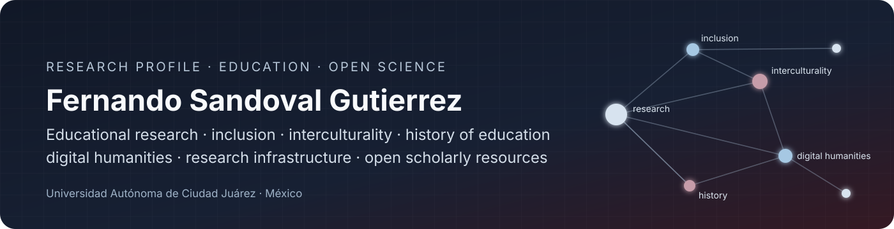

<p align="center">
  
</p>

<p align="center">
  <strong>Profesor Investigador de Tiempo Completo · Universidad Autónoma de Ciudad Juárez</strong><br>
  Historia de la educación · formación docente · inclusión · interculturalidad · humanidades digitales · ciencia abierta
</p>

<p align="center">
  <a href="https://orcid.org/0000-0002-3168-6725"></a>
  <a href="https://scholar.google.com/citations?user=zNZsYYAAAAAJ&hl=es"></a>
  <a href="https://cathi.uacj.mx/handle/20.500.11961/3028/browse?authority=0000-0002-3168-6725&type=author"></a>
  <a href="https://www.researchgate.net/profile/Fernando-Sandoval-Gutierrez"></a>
  <a href="https://uacj.academia.edu/FernandoSandoval"></a>
</p>

<p align="center">
  
  
  
  
  
</p>

<p align="center">
  <a href="#infraestructuras-científicas"><strong>Infraestructuras científicas</strong></a> ·
  <a href="RESEARCH.md">Arquitectura de investigación</a> ·
  <a href="OUTPUTS.md">Producción</a> ·
  <a href="OPEN-SCIENCE.md">Ciencia abierta</a> ·
  <a href="PROFILE.en.md">English</a>
</p>

---

## Research hub

Este perfil funciona como **puerta de entrada al ecosistema científico** que desarrollo en GitHub. Los repositorios no se presentan como proyectos aislados: forman una arquitectura de investigación que conecta historia de la educación, diversidad lingüística, fuentes históricas, educación intercultural, desarrollo de recursos pedagógicos y métodos reproducibles de humanidades digitales.

El criterio transversal es que cada objeto digital pueda distinguir con claridad **fuente, transformación, versión, procedencia, validación, licencia y alcance epistemológico**. Cuando un dato no ha sido validado por personas expertas o comunidades, esa ausencia debe permanecer visible.

## Infraestructuras científicas

<table>
<tr>
<td width="50%" valign="top">

### 🪶 [Rarámuri Digital](https://github.com/fersandovalgtz/raramuri-digital)

<p>
<a href="https://doi.org/10.5281/zenodo.21483353"></a>
<a href="https://github.com/fersandovalgtz/raramuri-digital/actions/workflows/validate.yml"></a>
</p>

Infraestructura lexicográfica rarámuri–español con **2,581 entradas**, API pública, exportaciones interoperables, TEI Lex-0, CLDF, metadatos científicos, procedencia, control de calidad y preservación. La validación lingüística y comunitaria permanece diferenciada de la validación técnica.

</td>
<td width="50%" valign="top">

### 📜 [Cahíta Histórico Digital](https://github.com/fersandovalgtz/cahita-historico-digital)

<p>
<a href="https://doi.org/10.5281/zenodo.22061986"></a>
<a href="https://github.com/fersandovalgtz/cahita-historico-digital/actions/workflows/qa.yml"></a>
</p>

Edición histórico-digital reproducible del *Arte de la lengua cahita* de 1737. Integra **2,302 artículos lexicográficos**, 2,072 candidatos canónicos, gramática estructurada, TEI Lex-0, CLDF, contratos JSON Schema, FAIR/CARE y preservación explícita de incertidumbre.

</td>
</tr>
<tr>
<td width="50%" valign="top">

### 🗂️ [Rarámuri Histórico](https://github.com/fersandovalgtz/raramuri-historico)

<p>
<a href="https://doi.org/10.5281/zenodo.21958018"></a>

</p>

Infraestructura para vocabularios y testimonios históricos rarámuri con capas canónicas, procedencia, relaciones documentales, TEI, TEI Lex-0, IIIF, formatos estructurados y replicación controlada sobre nuevas fuentes. Distingue sistemáticamente evidencia, propuesta editorial y validación humana.

</td>
<td width="50%" valign="top">

### 📚 [Libro de Texto Mexicano Digital](https://github.com/fersandovalgtz/libro-texto-mexicano-digital)

<p>


</p>

Infraestructura de historia de la educación y humanidades digitales para estudiar longitudinalmente libros de texto mexicanos. Su universo U1 registra **542 visores** y separa identidad documental, resolución técnica, OCR, segmentación, derivados computacionales, validación humana e interpretación histórica.

</td>
</tr>
<tr>
<td colspan="2" valign="top">

### 🎓 [Rarámuri · recursos educativos](https://github.com/fersandovalgtz/raramuri-recursos-educativos)

<p>
<a href="https://github.com/fersandovalgtz/raramuri-recursos-educativos/actions/workflows/validate-repository.yml"></a>

</p>

Capa pedagógica complementaria a Rarámuri Digital para actividades, cuadernos y recursos educativos. Su diseño exige procedencia, documentación de variantes, seguridad cultural y separación entre revisión técnica, revisión por personas hablantes y revisión comunitaria.

</td>
</tr>
</table>

## Arquitectura común de calidad

Los repositorios científicos convergen progresivamente en un estándar común:

| Dimensión | Implementación esperada |
|---|---|
| Identidad | versiones, tags y DOI cuando existe depósito real |
| Citación | `CITATION.cff` + ORCID |
| Metadatos | CodeMeta y metadatos específicos del dominio |
| Procedencia | fuentes, transformaciones, hashes y relaciones documentales |
| Reproducibilidad | scripts, dependencias, CI, tests e invariantes |
| Interoperabilidad | formatos abiertos y estándares de comunidad cuando corresponden |
| Gobernanza | atribución, derechos, límites de autoridad y revisión |
| FAIR / FAIR4RS | autoevaluación documentada, sin badges de certificación ficticia |
| CARE | criterio ético adicional en recursos vinculados con pueblos y lenguas indígenas |
| Publicación | releases inmutables y preservación externa cuando procede |

## Principio metodológico

```text
fuente
  ↓
representación de trabajo
  ↓
transformación reproducible
  ↓
dato derivado
  ↓
validación explícita
  ↓
interpretación científica
```

La automatización puede ampliar cobertura y reproducibilidad; no sustituye por sí misma autoridad filológica, lingüística, pedagógica o comunitaria.

## Perfiles académicos

[ORCID](https://orcid.org/0000-0002-3168-6725) · [Google Scholar](https://scholar.google.com/citations?user=zNZsYYAAAAAJ&hl=es) · [CATHI-UACJ](https://cathi.uacj.mx/handle/20.500.11961/3028/browse?authority=0000-0002-3168-6725&type=author) · [ResearchGate](https://www.researchgate.net/profile/Fernando-Sandoval-Gutierrez) · [Academia.edu](https://uacj.academia.edu/FernandoSandoval)

---

<p align="center">
  <strong>Fernando Sandoval Gutierrez</strong><br>
  <sub>Research profile · Universidad Autónoma de Ciudad Juárez · México</sub>
</p>
